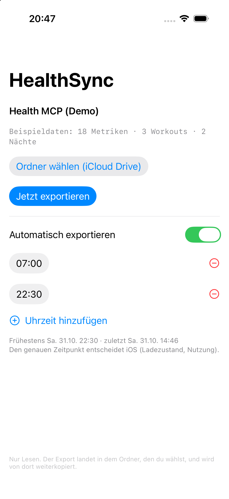
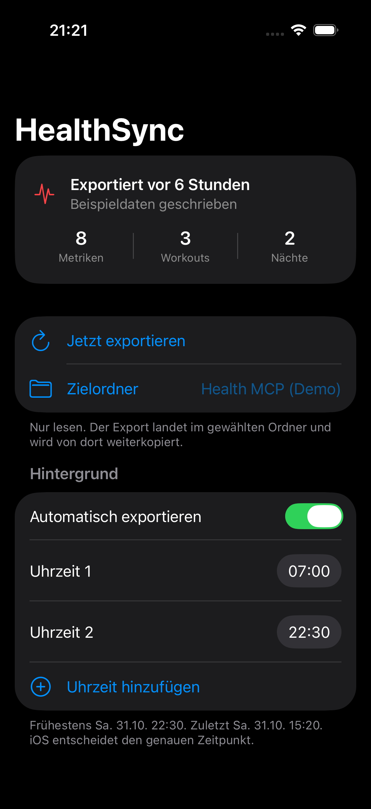
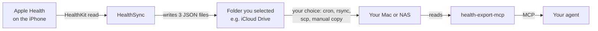

# HealthSync

HealthSync is a small app for iOS. It reads Apple Health and writes three JSON files into a folder
that you select. Point a reader at these files. Then you have your own health data pipeline. You
need no subscription and no cloud account.

The reader that this app was made for is
[`health-export-mcp`](https://github.com/inkandswitch/health-export-mcp). That program serves the
files to an AI agent over MCP.

The alternative was a paid app that costs 24.99 EUR. This app is approximately 700 lines of Swift
code and it uses a free Apple developer account.

 

*The screenshots show the `-seed` demo fixture in the simulator. The values are sample data. They
are not a health record.*

---

## What it does

- The app reads 18 health data types. These types include steps, energy, sleep, heart rate, HRV,
  resting heart rate, VO2max, oxygen saturation, respiratory rate, exercise time, stand time and
  flights climbed.
- The app reads a rolling period of 730 days. It aggregates the values for each day.
- The app reads all workouts. Each workout has distance, energy, average heart rate and peak
  heart rate.
- The app groups sleep samples into sessions. A split night stays two sessions. The app does not
  make one artificial block.
- The app writes the data into the folder that you select. You can start the export manually or
  with a schedule.
- The app never writes to HealthKit. It only reads the data.

## The pipeline



No service operates between the app and your computer. There is no account, no API key and no
vendor. The app writes files. You select the transport to the computer that reads them.

## Install

You need Xcode 15 or later, iOS 17 or later, and
[XcodeGen](https://github.com/yonaskolb/XcodeGen) (`brew install xcodegen`). A free Apple developer
account is sufficient.

1. Run `TEAM_ID=YOURTEAMID xcodegen generate`. Use your 10-character team ID.
2. Run `open HealthSync.xcodeproj`.
3. Select your iPhone as the run destination.
4. Press Command-R.

Xcode registers the device and makes the provisioning profile. A script cannot do this step.
If iOS blocks the app, open *Settings > General > VPN & Device Management* and trust your developer
certificate.

The project reads `DEVELOPMENT_TEAM` from the `TEAM_ID` environment variable. Therefore no team ID
is in the repository. Set the variable one time for each generated project. Or edit `project.yml`.

## First run

1. Open the app.
2. Allow Apple Health read access for the data types that you need.
3. Tap **Ordner wählen (iCloud Drive)** and select an empty folder.
4. Tap **Jetzt exportieren**. The app writes three files into the folder.

The first full export takes approximately 35 seconds on an iPhone. The data covers two years.

The app saves a bookmark and it does not save a path. Therefore a moved folder stays valid. The app
needs no iCloud entitlement for this method.

## Automatic export

iOS has no cron. The toggle **Automatisch exportieren** and the times make a
`BGProcessingTaskRequest`. The `earliestBeginDate` is the next time in your list.

- The time is a hint. It is not an alarm. iOS selects the real start time. iOS usually starts the
  task when the phone is idle or on a charger. The screen shows the earliest time and the last real
  run.
- The app uses a processing task and not an app-refresh task. A full export takes approximately 35
  seconds. iOS stops an app-refresh task after 30 seconds.
- Background App Refresh must be on. Low Power Mode must be off. You must unlock the phone one time
  after a boot.
- A force-quit of the app cancels the task. A reboot cancels a pending request.
- You can set more than one time for each day. iOS keeps one pending request for each identifier.
  Therefore the app sorts the list and removes duplicate entries.

If you open the app, the app exports immediately. The schedule does not change this behavior.

## What it writes

| file | contents |
|---|---|
| `.health-cache.json` | one value for each day and each of the 18 data types, plus a `_meta` block |
| `.health-workouts-cache.json` | one row for each workout: start, name, type, distance, energy, average heart rate and peak heart rate |
| `health-sessions.json` | sleep sessions: start, end, waking day, hours of sleep and the stages core, deep, rem and awake |

A session ends when two sleep samples are more than one hour apart. The daily sleep hours and the
sessions come from the same HealthKit samples. Therefore they cannot disagree.

```jsonc
// .health-cache.json (shortened)
{
  "step_count": { "unit": "count", "cumulative": true,
                  "daily": [ { "d": "2026-10-30", "v": 8412 }, ... ] },
  "_meta": { "schema": 1, "writtenAt": "2026-10-31T06:12:03Z",
             "requested": 18, "written": 16, "sessions": true }
}
```

The schema number is a contract. `health-export-mcp` rejects a cache with an unknown schema number.

## Design notes

**Aggregation.** The app uses `HKStatisticsCollectionQuery` with intervals of one day. It uses `sum`
for cumulative data types. It uses `mean` for the other data types. The app does not sum the sleep
values. It counts the sleep from the samples.

**Atomic writes.** The app writes each file to a temporary name and then renames the file. The
export stops if fewer than two data types return a value. Therefore a failed read cannot erase a
valid cache.

**Percentages.** `HKUnit.percent()` returns a value from 0 to 1. The `export.xml` file of Apple
returns a value from 0 to 100. Divide the value only in a converter for a manual export.

**Workout names.** The activity type of Apple is an integer. The app uses a generated table with 86
entries and not a `switch` statement. Therefore an unknown future type shows "Other" and the build
does not fail.

**Security-scoped URLs.** A folder that you select with `.fileImporter` is valid only between
`startAccessingSecurityScopedResource()` and the matching stop call. A bookmark operation outside
this range fails with the message *"The file couldn't be opened because it doesn't exist."*

## Limits

- Free provisioning expires after 7 days. Run the app from Xcode again to sign it. A paid
  membership (99 EUR for one year) removes this limit.
- Background export is best effort. Low Power Mode, a busy phone or a reboot can skip a time. The
  schedule is a convenience and not a guarantee. The screen shows the last real run.
- HealthKit does not operate in the iOS simulator. You can test only the writing path there. Use the
  `-seed` launch argument for this test.
- The app shows weight and body fat only if a scale writes these values to Apple Health. The app
  does not invent a value.
- The app uses one folder only. Two destinations are not possible.

## Repository layout

```
HealthSync/HealthSyncApp.swift      the app: data types, exporter, folder bookmark,
                                    schedule, background task, UI, DEBUG seeder
HealthSync/Assets.xcassets          app icon
HealthSync/Info.plist               HealthKit usage strings, background modes
HealthSync/HealthSync.entitlements  com.apple.developer.healthkit
project.yml                         XcodeGen source (the .xcodeproj is generated)
tools/make-icon.py                  draws the icon with Pillow
tools/check-ste.py                  checks the README against the STE limits
docs/designs/                       design document
reports/                            review and readiness reports
docs/screenshots/                   the images above
```

## Privacy

The app has no network code, no analytics, no third-party dependency and no account. It reads
HealthKit and it writes files into the folder that you selected. The next tool is responsible for
these files. This separation is the purpose of the design.

## License

MIT. See [LICENSE](LICENSE).
