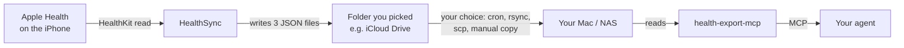

# HealthSync

**Your Apple Health data on your own machine, without a subscription or a cloud account.**

HealthSync is a small iOS app that reads Apple Health and writes three JSON files into a folder you
pick — iCloud Drive, a local folder, anything. Point a reader at those files and you have your own
health data pipeline. The reader this was built for is
[`health-export-mcp`](https://github.com/inkandswitch/health-export-mcp), which serves the files to
an AI agent over MCP.

It exists because the alternative was a €24.99 one-time app. This is ~700 lines of Swift and a free
Apple developer account.

 

*(Screenshots from the simulator running its `-seed` demo fixture — the numbers are sample data,
not anyone's health record.)*

---

## What it does

- Reads **18 health quantity types** — steps, energy, sleep, heart rate, HRV, resting heart rate,
  VO₂max, oxygen saturation, respiratory rate, exercise and stand time, flights climbed, and more —
  over a rolling **730-day window**, aggregated per day.
- Reads every **workout** with distance, energy, average and peak heart rate.
- Clusters **sleep samples into sessions**, so a split night stays two sessions instead of one
  invented block.
- Writes all of it into a folder you choose, manually or on a schedule.
- **Never writes to HealthKit.** Read-only, always.

## The pipeline



Nothing in the middle is a service. No account, no API key, no vendor. The app writes files; how they
travel to the machine that reads them is your call. (On the author's setup: an iCloud folder, then a
`tar | ssh` sync every 15 minutes.)

## Install

Requirements: Xcode 15+, iOS 17+, and [XcodeGen](https://github.com/yonaskolb/XcodeGen)
(`brew install xcodegen`). A **free** Apple developer account is enough.

```sh
TEAM_ID=YOURTEAMID xcodegen generate     # your 10-character team id
open HealthSync.xcodeproj
```

Then pick your iPhone as the run destination and press **⌘R**. Xcode registers the device and creates
the provisioning profile — that part cannot be scripted. If iOS blocks the app afterwards:
*Settings → General → VPN & Device Management → trust your developer certificate.*

`DEVELOPMENT_TEAM` is read from the `TEAM_ID` environment variable so no team id is committed. Set it
once per generated project, or edit `project.yml` if you prefer.

## First run

1. Open the app, allow **Apple Health → read** for the types you care about.
2. Tap **Ordner wählen (iCloud Drive)** and pick an empty folder. The app keeps a bookmark, not a
   path, so it survives the folder moving — and needs no iCloud entitlement.
3. Tap **Jetzt exportieren**. Three files appear in that folder.

The first full export takes about 35 seconds on an iPhone for two years of data.

## Automatic export

iOS has no cron. The toggle **Automatisch exportieren** plus one or more times becomes a
`BGProcessingTaskRequest` whose `earliestBeginDate` is the next slot in your list:

- It is a **hint, not an alarm.** iOS decides when to actually run it — typically when the phone is
  idle or charging. The screen shows the earliest possible time and when it last really ran.
- It is a *processing* task, not an app-refresh task: a full export needs ~35 s and app-refresh tasks
  are killed at 30.
- It needs Background App Refresh on, no Low Power Mode, and the phone unlocked at least once since
  boot. Force-quitting the app cancels it. Pending requests do not survive a reboot.
- Several times per day are supported; the list is sorted and de-duplicated because iOS keeps exactly
  **one** pending request per identifier.

Opening the app always exports immediately, whatever the schedule says.

## What it writes

| file | contents |
|---|---|
| `.health-cache.json` | per-day values for 18 quantity types, plus `_meta` (schema, written-at, requested/written counts) |
| `.health-workouts-cache.json` | one row per workout: start, name, type, distance, energy, average and peak heart rate |
| `health-sessions.json` | clustered sleep sessions: start, end, waking day, hours asleep, split into core/deep/rem/awake |

A session ends where two sleep samples are more than **an hour** apart. Daily sleep hours and sessions
come from the same HealthKit samples, so they cannot disagree.

```jsonc
// .health-cache.json (abridged)
{
  "step_count": { "unit": "count", "cumulative": true,
                  "daily": [ { "d": "2026-10-30", "v": 8412 }, ... ] },
  "_meta": { "schema": 1, "writtenAt": "2026-10-31T06:12:03Z",
             "requested": 18, "written": 16, "sessions": true }
}
```

The schema number is a contract: `health-export-mcp` refuses a cache whose `schema` it does not know.

## Design notes worth knowing

**Aggregation.** `HKStatisticsCollectionQuery` with one-day intervals; `sum` for cumulative types,
`mean` for the rest. Sleep is deliberately not summed — it is counted from the samples directly.

**Atomic writes.** Each file is written to a temporary name and renamed into place, and the export
aborts if fewer than two metrics came back, so a failed read cannot blank a working cache.

**Percentages.** `HKUnit.percent()` is already 0…1. Apple's `export.xml` uses 0…100. If you convert a
manual export instead, divide only there.

**Workout names.** Apple's activity type is an integer enum. There is a generated 86-entry table rather
than a `switch`, so an unknown future type degrades to "Other" instead of failing to compile.

**Security-scoped URLs.** A folder picked through `.fileImporter` is only valid inside
`startAccessingSecurityScopedResource()`; bookmarking it outside that scope fails with
*"The file couldn't be opened because it doesn't exist."*

## Limits, honestly

- **Free provisioning expires every 7 days.** Re-run from Xcode to re-sign. A paid membership
  (99 €/year) removes this.
- **Background export is best effort.** Low Power Mode, a very busy phone, or a reboot will skip a
  slot. It is a convenience, not a guarantee — the schedule reports what actually happened.
- **HealthKit does not exist in the iOS simulator.** Only the writing path can be tested there, via
  the `-seed` launch argument, which runs the real writer on sample values.
- **No weight or body-fat data appears** unless a scale writes to Apple Health. Nothing in the app
  invents it.
- The app assumes **one** folder. Two destinations would need one bookmark each — not implemented.

## Repository layout

```
HealthSync/HealthSyncApp.swift      the whole app: specs, exporter, folder bookmark,
                                    schedule, background task, UI, DEBUG seeder
HealthSync/Assets.xcassets          app icon
HealthSync/Info.plist               HealthKit usage strings, background modes
HealthSync/HealthSync.entitlements  com.apple.developer.healthkit
project.yml                         XcodeGen source of truth (the .xcodeproj is generated)
tools/make-icon.py                  draws the icon with Pillow
docs/designs/                       design document
reports/                            review and readiness reports from the design phase
docs/screenshots/                   the images above
```

## Privacy

The app has no networking code, no analytics, no third-party dependencies, and no account. It reads
HealthKit and writes files to the folder you selected. Whatever happens to those files afterwards is
the next tool's business — that is the point of the design.

## License

MIT — see [LICENSE](LICENSE).
